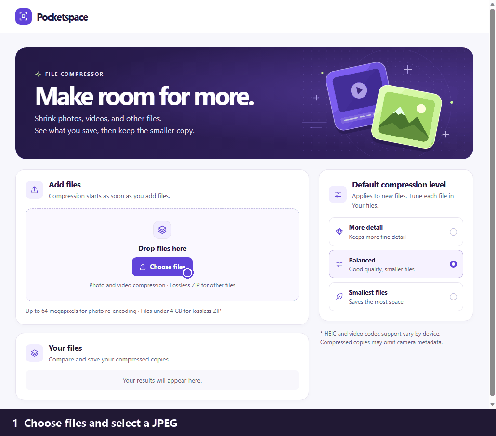

# Pocketspace

Pocketspace compresses photos, videos, and other files on your device. It runs as a Windows desktop app and can also run in a browser for local development.

## Windows download

Download `Pocketspace-Windows-x64.zip` from the [latest release](https://github.com/metanmai/pocketspace/releases/latest). Extract the ZIP and open `Pocketspace.exe` from the extracted folder. Keep the executable, DLLs, and `dist` folder together. Pocketspace requires 64-bit Windows, .NET Framework 4.6.2 or newer, and the Microsoft Edge WebView2 Runtime.

## Quick demo

1. Click **Choose files** and select a JPEG. Pocketspace compresses it and shows the savings in **Your files**.
2. Click **Tune** beside the photo. Choose **Percentage smaller**, enter **75**, and click **Update preview**. The photo in this demo went from 650 KB to 161 KB.
3. Switch between **Original** and **Compressed** to compare. Click **Save copy** to keep the smaller JPEG.

### Screenshots

## What you can do

- Compress photos and videos with a preset, a percentage reduction, or a target size. Compare the original and the compressed copy before saving.
- Apply settings to every queued file with the same extension.
- Compress other file types into a lossless ZIP when it saves space.
- In Windows, replace eligible originals in place after one batch confirmation. You can also save individual copies or prepare a ZIP for sharing.

## Development

Run `node serve.mjs` from the project root and open `http://127.0.0.1:4173`. Use a browser with WebCodecs support for video compression. The web assets live in `dist`. The Windows host and build instructions are in [desktop](desktop/README.md).
